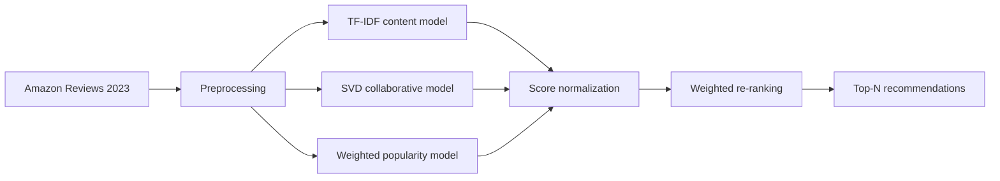

# Cross-Domain Hybrid Music Recommendation System

[](https://www.python.org/)
[](https://jupyter.org/)
[](LICENSE)

A recommender-system project that explores whether a user's musical-instrument interests can help recommend albums. The pipeline combines TF-IDF content similarity, SVD collaborative filtering, and popularity signals, then compares each component with a weighted hybrid re-ranker.

## Project highlights

- Processed **7,844,712 Amazon reviews** across musical instruments and CDs/Vinyl.
- Reduced the interaction set to **1,844,009 reviews**, **194,479 users**, and **112,942 items** using activity thresholds.
- Represented item titles and descriptions as a **112,942 x 20,000 TF-IDF matrix**.
- Trained an SVD model on instrument interactions and evaluated transfer to the music domain.
- Implemented a hybrid score using collaborative, content, and popularity signals.

## System design



The hybrid score used in the experiment is:

```text
final_score = 0.5 * collaborative + 0.3 * content + 0.2 * popularity
```

## Data pipeline

1. Load review and metadata files for `Musical_Instruments` and `CDs_and_Vinyl`.
2. Standardize user, item, rating, and text fields across both domains.
3. Retain items with at least 10 reviews and users with at least 5 interactions.
4. Clean title and description text and build TF-IDF embeddings.
5. Train popularity, content-based, and collaborative models.
6. Normalize model scores and produce a weighted Top-N ranking.

The raw dataset files are not included in this repository. The historical notebooks retain small rendered previews from exploratory analysis. See [data/README.md](data/README.md) for the source and expected filenames.

## Results

### Rating prediction

The cross-domain SVD experiment produced:

| Metric | Score |
|---|---:|
| RMSE | **0.9679** |
| MAE | **0.7682** |

### Top-10 ranking evaluation

The notebook evaluated up to 200 users with interactions rated 4 or higher as relevant items.

| Model | Precision@10 | Recall@10 | F1@10 | MRR@10 |
|---|---:|---:|---:|---:|
| Popularity | 0.0005 | 0.0002 | 0.0003 | 0.0007 |
| Content-based TF-IDF | **0.0925** | **0.2087** | **0.1123** | **0.8425** |
| Collaborative SVD | 0.0005 | 0.0005 | 0.0005 | 0.0007 |
| Hybrid re-ranking | 0.0050 | 0.0075 | 0.0055 | 0.0129 |

The notebook also printed values labeled `NDCG@10`, but its helper loses item correspondence before calling `ndcg_score`; those values are omitted here because they are not valid NDCG estimates. The content-based run produced the strongest displayed values, but its candidate and seed setup differs from the collaborative evaluation. These exploratory outputs therefore cannot establish cross-domain effectiveness or a fair model comparison.

## Repository structure

```text
.
├── data/
│   └── README.md
├── notebooks/
│   ├── 01_data_preprocessing_and_eda.ipynb
│   ├── 02_content_based_model.ipynb
│   ├── 03_collaborative_filtering.ipynb
│   └── 04_reranking_and_evaluation.ipynb
├── output/
│   └── README.md
├── requirements.txt
└── README.md
```

## Getting started

Use Python 3.10 or 3.11. The preprocessing notebook loads several million records, so plan for substantial memory and disk usage.

```bash
git clone https://github.com/sunwooJ110/music-recommendation-system.git
cd music-recommendation-system

python -m venv .venv
source .venv/bin/activate
pip install -r requirements.txt
jupyter lab
```

Download the four source files described in [data/README.md](data/README.md), place them in `data/`, and run the notebooks in numeric order. Generated datasets, embeddings, and models are written to `output/` and remain untracked.

## My contribution

I owned the final integration of the recommendation pipeline, including cross-domain setup, hybrid re-ranking, ranking metrics, result analysis, and final delivery. The original academic-project Git history is preserved so the development timeline and contributor metadata remain auditable.

## Limitations

- The ranking evaluation is exploratory and uses only the first 200 eligible users.
- The current content-based evaluation can include the seed item among candidates, so its ranking metrics may be optimistic.
- The notebook's legacy NDCG implementation must be corrected and recomputed before that metric can be reported.
- Instrument and music catalogs have disjoint item IDs. An SVD model trained only on instrument items cannot learn latent factors for unseen music items and relies heavily on fallback estimates.
- Hybrid weights were selected heuristically rather than tuned on a separate validation set.
- A production evaluation should use temporal or leave-one-out splits, exclude seen items, and tune weights on held-out users.

## Data source

[Amazon Reviews 2023](https://amazon-reviews-2023.github.io/) from the McAuley Lab at UC San Diego.

## Repository recovery note

This repository was rebuilt from an intact local Git clone after the original remote repository was deleted. The recovered branch and commit history were validated before publication.
